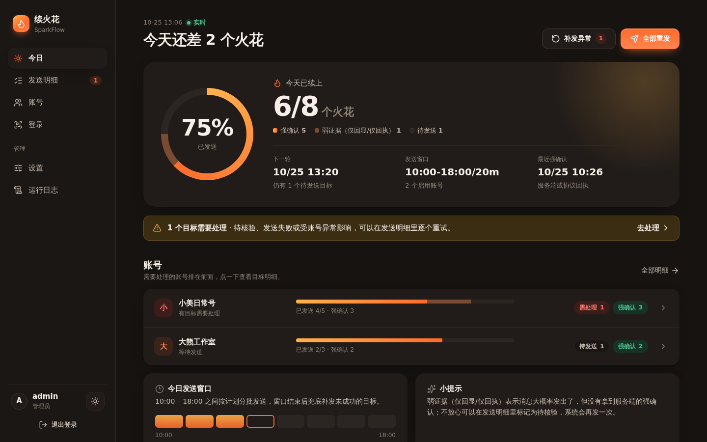
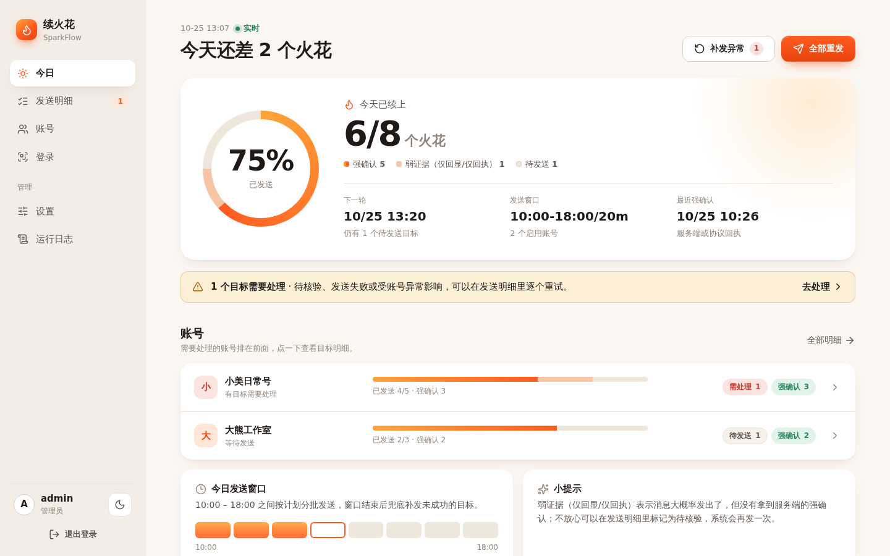

# 🔥 DouYin SparkFlow

<div align="center">

**抖音多账号火花自动维护系统**

自托管的抖音续火花工具：每天在发送窗口内给选定的好友和群聊发一条消息，支持多账号、发送前巡查、结果推送和 Web 控制台

[](https://github.com/halfwaystudent/douyin-sparkflow)
[](LICENSE)
[](https://www.python.org/)
[](https://linux.do)

[功能特性](#-功能特性) • [快速开始](#-快速开始) • [使用文档](#-使用文档) • [部署指南](#-部署指南) • [社区讨论](https://linux.do)

</div>

---

> ⚠️ **重要提示**
>
> 本项目是非官方的第三方公开源码项目，与抖音及其关联方不存在隶属、授权、赞助、代理或合作关系。
> 本项目自有代码采用 [PolyForm Noncommercial License 1.0.0](LICENSE)，仅授权非商业用途；未经版权持有人事先书面授权，不得将本项目用于收费服务、商业运营、商业账号管理、营销推广、客户代运营、商业产品集成或其他商业用途。
> 使用者只能操作本人拥有或已获得明确授权的账号，并须自行遵守抖音用户协议、相关法律法规及账号管理要求。自动化操作可能导致验证、限流、功能限制、账号封禁、登录态失效、数据丢失或其他后果。

## 📸 主界面预览

### 🌙 暗色模式

<div align="center">
  
  <p><i>Web 管理控制台 - 仪表盘视图（暗色主题）</i></p>
</div>

### ☀️ 亮色模式

<div align="center">
  
  <p><i>Web 管理控制台 - 仪表盘视图（亮色主题）</i></p>
</div>

---

## ✨ 功能特性

### 🎯 续火花

- **🔄 每日自动发送**：在你设置的发送窗口内分批发送，每个目标一天只发一次
- **👥 好友目标**：在账号页刷新好友列表后勾选；按好友 UID 绑定，好友改昵称后自动跟随
- **💬 群聊目标**：刷新群列表后勾选，按群会话编号绑定，群改名或有同名群都不会发错
- **🛡️ 宁可不发，也不重发**：发送前核对聊天对象，对不上就跳过并记录原因；发送结果不确定时标为“待核验”，当天不会自动重发
- **🎨 消息模板**：自定义模板、一言、节日祝福，可设置多条随机使用

### 🔍 巡查与提醒

- **🚓 发送前巡查**：发送窗口开始前半小时只读检查一遍：登录是否有效、登录的是不是这个账号、目标好友和群是否还在、有没有改名。巡查不打开聊天，也不发消息
- **🔔 结果推送**：发送失败、巡查发现问题、登录失效时推送到 Telegram、钉钉、企业微信或通用 Webhook，并每天发一份汇总
- **📋 发送明细**：每个目标的结果按证据分级（服务端确认 / 页面回显 / 仅回执），可单独重试

### 🔑 账号与登录

- **👥 多账号**：集中管理多个抖音账号，每个账号单独配置目标
- **📱 扫码或 Cookie 登录**：在网页里的登录工作区扫码，或粘贴 Cookie；保存前会在真实浏览器里验证
- **🪪 身份绑定**：重新登录时核对抖音账号身份，防止把登录态存到别的账号下
- **🧑‍🤝‍🧑 子用户**：管理员可以添加面板用户，每个用户只能看到分配给自己的抖音账号

### 🛠️ 技术特性

- **🌐 Web 控制台**：FastAPI + 原生 JavaScript，手机也能用，支持亮色/暗色主题
- **🔌 浏览器自动化**：基于 Playwright，每个账号使用独立的持久化浏览器配置
- **🐳 Docker 部署**：一条命令起全部服务，同时支持 x86 和 ARM（Apple Silicon）
- **🌍 网络回退**：默认直连抖音，直连不通时再走 Mihomo 代理
- **🔒 账号互斥**：发送、刷新好友/群列表、巡查和登录共用账号锁，不会同时打开同一个账号

---

## 🚀 快速开始

### 前置要求

- Python 3.10 或更高版本（代码使用了 `X | None` 之类的 PEP 604 语法，3.9 会在导入时报错）
- Node.js 18+ 或 Docker（仅在使用协议发送通道时需要，用于运行 `core/protocol_sender.mjs`）
- Docker 和 Docker Compose（用于容器部署）
- 稳定的网络连接
- 你自己的抖音账号（本项目不附带任何账号、Cookie 或好友数据，首次使用需在面板里扫码登录）

### 📦 安装部署

<details open>
<summary><b>🐳 方式一：Docker 一键部署（推荐）</b></summary>

**适用场景**：服务器部署、生产环境

> **Apple Silicon（M 系列）**：默认 Playwright 基础镜像同时支持 `amd64` 和 `arm64`，无需指定 `platform`。如需设置 `PLAYWRIGHT_BASE_IMAGE` 使用镜像站，请确认所选镜像也提供 `arm64`；这只解决容器镜像架构兼容性，不保证抖音登录流程可用。

```bash
# 1. 克隆仓库
git clone https://github.com/halfwaystudent/douyin-sparkflow.git
cd douyin-sparkflow

# 2. 创建本地环境变量
cp .env.example .env
nano .env  # 根据需要修改配置
# 可选：在本地 .env 中填写 PROXY_SUB_URL，不要提交真实订阅地址

# 3. 初始化运行时文件并启动服务
# 会创建 proxy/config.yaml；没有订阅时使用 DIRECT-only 配置
bash ./deploy/install-local.sh

# Windows PowerShell 使用：
# powershell -ExecutionPolicy Bypass -File .\deploy\install-local.ps1

# 4. 访问 Web 界面
# 浏览器打开 http://localhost:8787
```

**服务端口说明**：
- `8787`：Web 管理控制台，默认监听全部网卡
- `8788`：noVNC 登录桌面，默认只绑定 `127.0.0.1`
- `7890` / `9090`：代理和控制端口，默认只绑定 `127.0.0.1`

服务器远程访问 noVNC 时，请先建立 SSH 隧道：

```bash
ssh -L 8788:127.0.0.1:8788 <user>@<server-ip>
```

然后打开 `http://127.0.0.1:8788/vnc.html?autoconnect=1&resize=scale&view_only=0`。

</details>

<details>
<summary><b>💻 方式二：本地开发运行</b></summary>

**适用场景**：本地开发、功能测试

```bash
# 1. 克隆仓库
git clone https://github.com/halfwaystudent/douyin-sparkflow.git
cd douyin-sparkflow/DouYinSparkFlow

# 2. 安装依赖
pip install -r requirements.txt
pip install -r requirements-web.txt

# 3. 安装 Playwright 浏览器
playwright install chromium

# 4. 启动 Windows 本地登录浏览器（另开一个 PowerShell）
.\scripts\start_login_desktop.ps1

# 5. 启动 Web 服务（再开一个终端）
python main.py --web

# 6. 访问 http://localhost:8787
```

</details>

### 🎬 使用流程

1. **登录账号** → 在「登录」页扫码或粘贴 Cookie，登录抖音账号
2. **选择目标** → 在「账号」页刷新好友列表和群列表，勾选需要续火花的好友和群
3. **配置任务** → 在「设置」里调整发送窗口、消息模板和推送通知
4. **查看进度** → 「今日」页显示还差几个火花、下一轮发送时间和巡查结果
5. **处理异常** → 在「发送明细」查看每个目标的结果并单独重试；巡查发现问题时会推送提醒

📖 详细使用教程请查看 [使用文档](docs/usage.md)

---

## 📂 项目结构

```
douyin-sparkflow/
├── DouYinSparkFlow/              # 核心应用源码
│   ├── core/                     # 核心功能模块
│   │   ├── tasks.py              # 发送任务与调度（核心）
│   │   ├── streak_state.py       # 每个目标的发送状态与失败分类
│   │   ├── friends.py            # 好友列表读取
│   │   ├── friend_identity.py    # 好友 UID 绑定与改名跟随
│   │   ├── groups.py             # 群列表读取（只读）
│   │   ├── patrol.py             # 发送前巡查（只读）
│   │   ├── notifications.py      # 推送事件的去重与汇总
│   │   ├── identity.py           # 抖音账号身份核对
│   │   ├── browser.py            # 浏览器、持久化配置与账号锁
│   │   ├── login.py / cookies.py # 登录与 Cookie 校验
│   │   ├── msg_builder.py        # 消息内容构建
│   │   └── protocol_*.{py,mjs}   # 协议发送通道（可选，仅好友）
│   ├── webui/                    # Web 控制台
│   │   ├── app.py                # FastAPI 主应用
│   │   ├── auth.py / users.py    # 登录认证与子用户
│   │   ├── ops.py                # 运维与概览数据
│   │   ├── static/               # 静态资源（CSS/JS）
│   │   └── templates/            # HTML 模板
│   ├── utils/                    # 配置、日志、推送渠道、一言等
│   ├── scripts/                  # 定时任务与辅助脚本
│   ├── tests/                    # 单元测试
│   ├── main.py                   # 主入口（--web / --doTask / --patrol）
│   └── login_desktop_server.py   # 登录桌面服务
├── .github/workflows/            # GitHub Actions 测试（只跑测试，不发送）
├── deploy/                       # 一键部署脚本
├── docs/                         # 使用文档
├── proxy/                        # 代理配置模板
├── docker-compose.yml            # 容器编排配置
├── .env.example                  # 环境变量模板
└── README.md                     # 本文件
```

---

## 📖 使用文档

### 🔑 账号管理

- **扫码 / Cookie 登录**：在登录工作区用抖音 APP 扫码，或粘贴 Cookie，保存前会验证
- **多账号支持**：可同时管理多个账号，独立配置每个账号的目标
- **登录态保持**：每个账号有独立的持久化浏览器配置，无需频繁重新登录
- **状态监控**：巡查和发送都会检查登录状态，失效时暂停该账号并推送提醒

### 🎯 好友与群聊目标

- **好友**：在「账号」页点「刷新好友列表」后勾选，或每行手动填写一个昵称。勾选的好友会绑定 UID，改昵称后自动跟随
- **群聊**：点「刷新群列表」后勾选，列表显示为 `群名（会话编号）`。程序按编号找群并在发送前核对，群改名照常发送，有同名群也不会发错
- **手动填写群名**：也可以不绑定编号，直接填写群名；此时要求群名在列表第一屏里唯一，否则跳过
- 群聊目标只支持浏览器发送通道，协议发送通道仅用于好友

### 🚓 巡查与推送

- **巡查**：每天发送窗口开始前半小时自动运行，也可以在「账号」页点「立即巡查」。结果显示每个好友和群是「找到 / 缺失 / 已改名」
- **推送渠道**：在「设置」里配置 Telegram、钉钉、企业微信或通用 Webhook；同一问题每天只推一次，另有每日汇总

### 📝 消息管理

**内置模板类型**：
- **一言（Hitokoto）**：随机诗词、名言警句
- **节日祝福**：自动识别节假日，发送对应祝福语
- **自定义消息**：支持纯文本自定义消息

**发送策略**：
- 时间窗口设置（如：09:00-22:00）
- 可配置发送间隔与限速，用于降低操作频率和对消息接收方的打扰；不保证规避平台风控，也不保证账号不会受到平台处理
- 发送失败按类别处理：可重试的失败会在窗口内重试，结果不确定的标为“待核验”，不会自动重发
- 发送确认分级：服务端确认、页面回显、仅回执，在「发送明细」中分别显示

### ⚙️ 配置说明

<details>
<summary>点击查看配置文件说明</summary>

#### `.env` - 环境变量配置

```bash
WEB_BIND_ADDRESS=0.0.0.0
WEB_PORT=8787

# noVNC 默认仅允许本机或 SSH 隧道访问
LOGIN_DESKTOP_BIND_ADDRESS=127.0.0.1
LOGIN_DESKTOP_WEB_PORT=8788
LOGIN_DESKTOP_PUBLIC_URL=/login-desktop/proxy/vnc.html?autoconnect=1&resize=scale&view_only=0&path=login-desktop/proxy/websockify

# 登录浏览器默认先直连抖音，直连失败时再尝试 Mihomo
LOGIN_DESKTOP_PROXY_MODE=auto
LOGIN_DESKTOP_PROXY=http://proxy:7890


# Mihomo 代理和控制端口默认仅绑定本机
PROXY_BIND_ADDRESS=127.0.0.1
PROXY_HTTP_PORT=7890
PROXY_CONTROLLER_PORT=9090
# 可选：Mihomo/Clash 订阅地址。通常包含敏感 token，只写入本地 .env。
PROXY_SUB_URL=
```


登录、好友刷新和发送任务默认都采用“直连优先，Mihomo 回退”的网络策略。`LOGIN_DESKTOP_PROXY_MODE=auto` 时，登录浏览器先直连 `creator.douyin.com`，直连预检失败后才使用 `LOGIN_DESKTOP_PROXY`。好友刷新和续火花任务也会在任务开始前选择可用出口；发送动作开始后不会因响应不明确而盲目切换代理重发。没有配置有效订阅时，Mihomo 仅提供 DIRECT-only 配置，回退不会凭空产生代理节点。


#### `config.example.json` 与 `config.json` - 应用配置

仓库跟踪 `DouYinSparkFlow/config.example.json`；首次运行会生成被 Git 忽略的 `DouYinSparkFlow/config.json`。常用配置示例：

```json
{
  "messageTemplate": "✨今日火花+1\n",
  "useProtocolSender": false,
  "browserSenderAccounts": [],
  "dailySendWindow": {
    "enabled": true,
    "startHour": 10,
    "endHour": 18,
    "scheduleIntervalMinutes": 20
  },
  "friendListScan": {
    "maxScanSeconds": 300,
    "idleScanSeconds": 120,
    "scrollStepPx": 400,
    "scrollDelaySeconds": 0.8
  },
  "persistentBrowserProfiles": {
    "enabled": true,
    "root": "/opt/douyin-sparkflow/state/browser-profiles",
    "seedCookiesWhenEmpty": true,
    "syncStoredCookiesBeforeRun": true,
    "refreshStoredCookiesAfterLogin": true
  }
}
```

`usersData.json`、`webui_settings.json`、浏览器 Profile、Cookie 和日志均为运行时敏感数据，不应提交到 Git。

</details>

---

## 🐳 部署指南

### Docker Compose 部署（推荐）

本项目提供完整的 Docker Compose 配置，包含以下服务：

- **web**（容器名 `douyin-web`）：Web 管理控制台服务
- **login-desktop**: 登录桌面服务（包含浏览器环境）
- **proxy**: Mihomo 代理服务（可选）
- **scheduler**: 发送窗口定时调度服务
- **task**: 一次性发送任务服务

定时任务由 `scheduler` 容器直接运行 `/app/main.py --doTask`，不再通过
`docker ps` 和 `docker exec` 控制 `web` 容器，因此 scheduler 不需要挂载宿主机
Docker socket。旧部署中已经写入的共享定时文件，会在 scheduler 启动时自动迁移；
服务器更新脚本还会备份并清理宿主机 root crontab 中旧的 Docker 发送任务，避免两套
定时器同时运行。

#### 快速部署

```bash
# 1. 准备环境变量
cp .env.example .env

# 2. 初始化 proxy/config.yaml 并启动所有服务
bash ./deploy/install-local.sh

# 3. 查看日志
docker compose logs -f

# 4. 停止服务
docker compose down
```

#### 仅部署 Web 服务

```bash
docker compose up -d web
```

### 服务器部署最佳实践

<details>
<summary>查看部署建议</summary>

#### 系统要求

- **CPU**: 2 核心或以上
- **内存**: 2GB 或以上
- **存储**: 10GB 可用空间
- **系统**: Ubuntu 20.04+ / CentOS 7+ / Debian 10+

#### 持久化数据

以下目录建议挂载为数据卷：

```yaml
volumes:
  - ./state:/app/state          # 运行状态数据
  - ./logs:/app/logs            # 日志文件
  - ./DouYinSparkFlow:/app      # 应用代码（开发环境）
```

#### 网络配置

如需外网访问，建议配置反向代理（Nginx/Caddy）：

```nginx
# Nginx 配置示例
server {
    listen 80;
    server_name sparkflow.example.com;
    
    location / {
        proxy_pass http://localhost:8787;
        proxy_set_header Host $host;
        proxy_set_header X-Real-IP $remote_addr;
    }
}
```

#### 安全建议

- ✅ 首次访问面板时创建管理员账号，并使用足够强的密码（系统不提供默认密码）
- ✅ 启用 HTTPS（使用 Let's Encrypt）
- ✅ 配置防火墙规则
- ✅ 定期备份 `state/` 和 `usersData.json`
- ✅ 使用环境变量管理敏感配置

</details>

---

## 🔧 高级配置

### 代理配置

项目支持通过代理访问抖音服务。仓库提供 `proxy/config.example.yaml` 作为安全模板，部署脚本会在启动前生成本地的 `proxy/config.yaml`：

```yaml
mixed-port: 7890
allow-lan: true
mode: rule
# ... 更多配置见 proxy/config.example.yaml
```

如果 `PROXY_SUB_URL` 不为空，`refresh_proxy.sh` 会下载订阅并更新本地配置；如果为空，则生成 DIRECT-only 配置。不要在 Git 中提交包含订阅 token 的 `proxy/config.yaml`。首次部署不要跳过初始化步骤直接执行 `docker compose up -d`，否则 Docker 可能把缺失的配置文件创建成目录。

Mihomo 控制接口（9090）需要密码才能访问。`refresh_proxy.sh`（以及 Windows 的 `deploy/install-local.ps1`）第一次运行时会生成一个随机密码，保存在 `state/proxy/controller-secret`，并写入 `proxy/config.yaml` 的 `secret`；之后刷新订阅也会沿用同一个密码。想自己指定时，在 `.env` 中设置 `PROXY_CONTROLLER_SECRET`（只能包含字母、数字和 `. _ ~ -`），再运行一次 `refresh_proxy.sh`。通过 SSH 隧道用 metacubexd 等面板连接控制接口时，需要填写这个密码：

```bash
cat state/proxy/controller-secret
```

如果宿主机 Docker Engine 较旧，Web 容器中的 Docker 运维功能可能需要显式指定
`DOCKER_API_VERSION`。默认留空即可；只有确认宿主机 API 版本后，才在 `.env` 中设置，
例如 `DOCKER_API_VERSION=1.43`。


### 默认网络安全

noVNC、Mihomo 代理端口和控制端口默认仅绑定 `127.0.0.1`。远程服务器请优先通过 SSH 隧道、VPN 或带认证的 HTTPS 反向代理访问，不建议直接把 8788、7890、9090 暴露到公网。

Web 通过 HTTPS 反向代理部署时，可设置 `SPARKFLOW_SESSION_COOKIE_SECURE=1`。

### 持续集成（GitHub Actions）

工作流位于 `.github/workflows/tests.yml`，在每次 `push`、`pull_request` 或手动触发时运行：Python 单元测试、字节码编译检查（`compileall`）以及 Node 侧的协议发送器测试（`node --test`）。它**不使用任何 Secret、不启动浏览器、不发送任何消息**，因此 fork 和外部 PR 也能运行同一套检查。

> 早期版本曾包含一个会在 GitHub 上执行真实发送的定时工作流（`.github/workflows/schedule.yml`，依赖 `user-data` 环境里的 `USER_DATA` Secret）。该工作流已在 2026-09 移除：从云端机房 IP 使用账号登录态发消息既不必要，也容易触发平台风控。如果你曾为它配置过 `USER_DATA`，可以删除该 Secret。需要定时发送时，请使用本项目自带的调度（面板里的自动发送窗口 + 容器内的 cron），它运行在你自己的服务器上。

---

## 📊 技术栈

- **后端框架**: FastAPI - 现代化的 Python Web 框架
- **前端**: HTML5 + CSS3 + Vanilla JavaScript
- **浏览器自动化**: Playwright - 跨浏览器自动化
- **容器化**: Docker + Docker Compose
- **代理**: Mihomo (Clash Meta)
- **任务调度**: `scheduler` 容器 + `scripts/cron_runner.py`（发送窗口与巡查）
- **模板引擎**: Jinja2

---

## ⚠️ 免责声明

### 非官方项目声明

本项目为第三方个人项目，与抖音及其关联方不存在隶属、授权、代理、赞助、技术支持或合作关系。项目名称中出现的“抖音”仅用于说明兼容目标或使用场景，不代表任何官方认可。

### 使用授权与账号责任

- 使用者只能操作本人拥有或已获得明确授权的账号。
- 不得使用他人未经授权的账号、Cookies、登录态、身份凭据或个人信息。
- 使用者应自行判断使用本项目是否符合适用的法律法规、抖音用户协议及其他平台规则。

### 平台风险与责任限制

- 抖音可能随时调整服务、接口、页面、风控策略和用户协议。
- 自动化操作可能导致验证码、限流、功能限制、账号异常、账号封禁、登录态失效或其他平台处理。
- 本项目不保证平台兼容性、持续可用性、账号安全或任何特定功能结果，也不提供规避平台风控或绕过平台限制的保证。
- 在法律允许的最大范围内，作者不对因使用、修改、部署或运行本项目产生的账号处置、数据丢失、服务中断、隐私泄露、业务损失或其他损害承担责任；法律不得排除或限制的责任除外。

### 消息内容与数据责任

- 使用者对自动发送的消息内容、发送对象、发送频率以及由此产生的骚扰、侵权、违法或其他纠纷承担相应责任。
- 登录态、Cookies、账号信息、好友信息和发送记录可能属于敏感数据。使用者应自行负责其存储、访问控制、备份、传输和删除，不得将相关数据提交到公开仓库、公开日志或不可信服务器。

### 商业使用限制

本项目自有代码采用 PolyForm Noncommercial License 1.0.0。未经版权持有人事先书面授权，禁止将本项目用于以下场景：

- 收费软件、收费脚本、收费镜像或收费部署服务；
- SaaS、托管服务、代运营或客户账号管理；
- 企业、品牌、店铺、主播或其他商业账号运营；
- 广告投放、商业推广、营销获客或客户维护；
- 将本项目集成到商业产品、商业平台或付费课程；
- 以部署、维护、代发、运营等方式向第三方收取费用；
- 其他直接或间接服务于营利性活动的场景。

如需将本项目用于商业场景，请事先联系版权持有人并取得单独的书面商业授权。未经书面授权，不得进行商业使用。

### 知识产权与侵权联系

本项目中的自有代码、文档、截图、图标和其他素材分别按照其适用的许可或权利声明使用。抖音名称、商标、页面内容、用户内容及相关数据的权利归相应权利人所有，本项目不主张取得任何相关权利。

如认为仓库中的特定文件侵犯了您的合法权益，请通过 [GitHub Issues](https://github.com/halfwaystudent/douyin-sparkflow/issues) 提交通知，并提供涉嫌侵权的具体文件路径或内容、权利归属或授权证明、侵权理由及可用于回复的联系方式。请勿在公开 Issue 中提交身份证件、账号凭据或其他敏感材料。维护者将在收到完整通知后进行核查，并根据核查结果采取替换、删除、断开访问或其他适当处理措施。

---

## 📝 更新日志

查看 [CHANGELOG.md](CHANGELOG.md) 了解版本更新历史。

**最近更新**（2026-10）：
- 💬 支持群聊目标：刷新群列表、勾选后按会话编号绑定，发送前核对，巡查也会检查群
- 🚓 新增发送前巡查：检查登录状态、账号身份和目标是否还在
- 🪪 好友按 UID 绑定，改昵称后自动跟随
- 🔔 新增推送通知：Telegram、钉钉、企业微信、通用 Webhook
- 🧑‍🤝‍🧑 支持子用户，各自管理分配给自己的抖音账号
- 📱 登录支持 Cookie，扫码登录保存后在后台验证
- 🐳 默认镜像同时支持 x86 和 ARM（Apple Silicon）

---

## 🤝 贡献

本项目目前作为个人项目维护，暂不接受外部 Pull Request。

如果你有：
- 🐛 **发现问题** - 欢迎提交 [Issue](https://github.com/halfwaystudent/douyin-sparkflow/issues) 报告 Bug
- 💡 **功能建议** - 欢迎在 Issue 中提出改进想法
- 🤔 **使用疑问** - 可以在 [Linux Do 社区](https://linux.do) 或 Issue 中讨论

感谢你的理解和支持！

---

## 📄 许可证

本项目自有代码采用 [PolyForm Noncommercial License 1.0.0](LICENSE)，仅授权非商业用途。本项目为公开源码项目，不授予商业使用权；如需商业使用，请事先取得版权持有人的书面授权。

第三方依赖、图标、字体、图片、截图、商标、平台内容及其他外部素材不自动继承本项目许可证，请以各自目录中的许可证、授权文件或上游项目声明为准；例如 Lucide 图标的许可证见 [`DouYinSparkFlow/webui/static/lucide-LICENSE.txt`](DouYinSparkFlow/webui/static/lucide-LICENSE.txt)。

---

## 🌟 Star History

[](https://star-history.com/#halfwaystudent/douyin-sparkflow&Date)

---

## 🔗 相关链接

- **项目主页**: [GitHub Repository](https://github.com/halfwaystudent/douyin-sparkflow)
- **社区讨论**: [Linux Do 社区](https://linux.do)
- **使用文档**: [docs/usage.md](docs/usage.md)
- **问题反馈**: [Issues](https://github.com/halfwaystudent/douyin-sparkflow/issues)

---

<div align="center">

**如果这个项目对你有帮助，请给个 ⭐ Star 支持一下！**

Made with ❤️ by [halfwaystudent](https://github.com/halfwaystudent)

</div>
