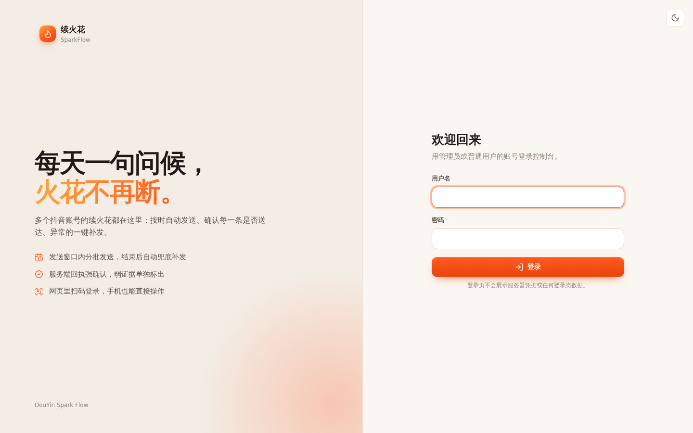
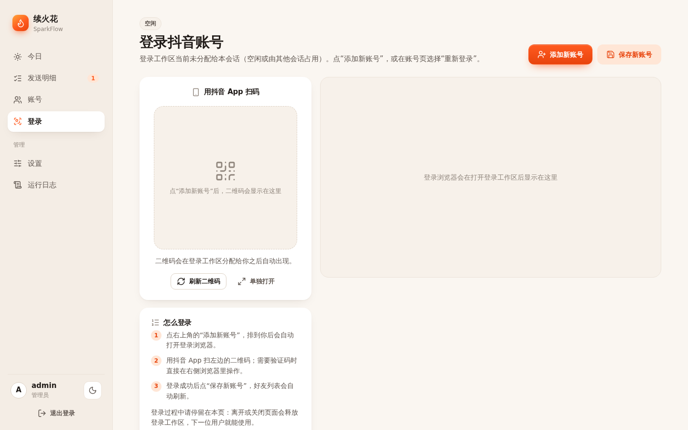
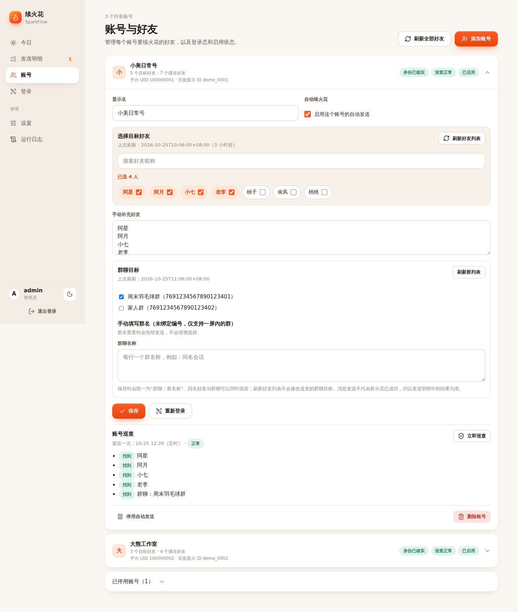
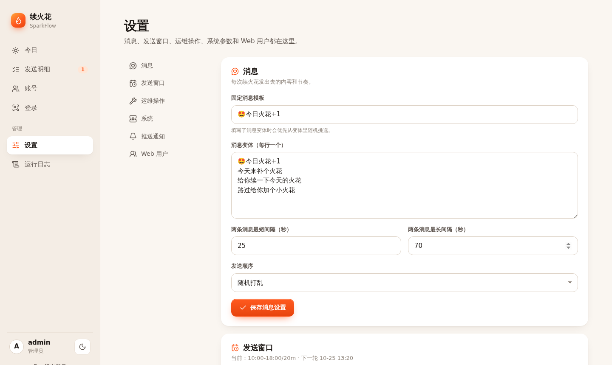
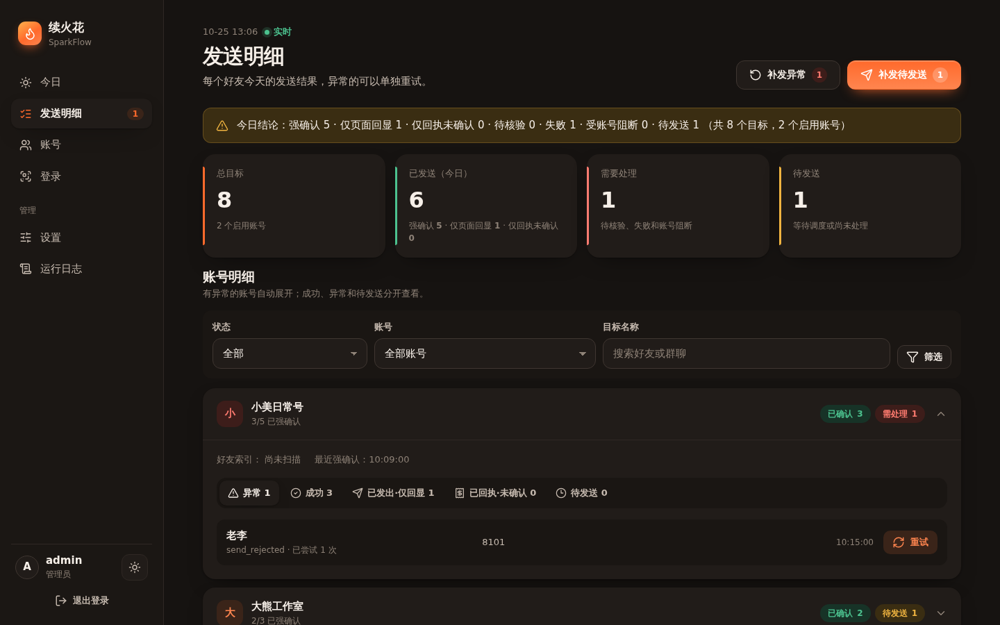

# 🔥 Douyin SparkFlow 使用教程

这份教程按第一次部署后的操作顺序写。你需要先完成服务器或本地部署，然后访问 Web 面板。

## 1. 登录控制台

打开 Web 面板地址，例如：

- 服务器部署：`http://服务器IP:8787`
- 本地部署：`http://127.0.0.1:8787`

首次打开时创建管理员账号。后续登录时输入管理员用户名和密码。



### 登录保护和密码

- 连续输错同一用户名和网络来源 5 次，会锁定这一组合 15 分钟。
- 同一用户名在不同网络来源累计输错 10 次后，会进入慢速模式：30 秒只能尝试一次。系统不会按整个 IP 地址锁定，避免同一网络中的其他人被一起锁住。
- 被锁时先停止反复尝试；可等待 15 分钟，或换一个网络后再登录。慢速模式只需等 30 秒再试。
- 新建或修改面板密码时，密码至少 10 位，且要包含字母、数字、符号中的至少两类；不能包含用户名，也不要使用重复字符组成的简单密码。已有密码不会因为这条规则而失效。

## 2. 查看今日进度

登录后进入 **今日** 页。标题会直接告诉你今天还差几个火花，下面是进度环、下一轮发送时间、需要处理的目标和每个账号的进度。

第一次打开时跟随手机或电脑的深浅色设置；点月亮/太阳图标可以手动切换，选择会保存在当前浏览器中。电脑上导航在左侧，手机上在底部标签栏。


## 3. 登录抖音账号

进入 **登录** 页，点 **添加新账号**。二维码会大图显示在左侧，远端浏览器在右侧，验证码等人工验证步骤直接在远端浏览器里完成。

noVNC 默认只监听服务器的 `127.0.0.1:8788`，管理后台会通过当前登录会话提供同源代理。电脑或手机直接在 **登录** 页操作即可。

手机端还会显示单独的大图二维码，可直接扫码，或长按保存后从抖音扫码页面读取相册图片。

如果需要直接访问 noVNC，也可以建立 SSH 隧道：

```bash
ssh -L 8788:127.0.0.1:8788 <user>@<server-ip>
```

然后访问 `http://127.0.0.1:8788/vnc.html?autoconnect=1&resize=scale&view_only=0`。登录完成后点击 **保存新账号**。



## 4. 维护账号、好友和群聊目标

进入 **账号** 页查看已保存的账号。你可以启用或停用账号，修改显示名，维护目标；登录态失效时点 **重新登录**，会带着这个账号跳到登录页。

### 好友目标

点击 **刷新好友列表**，再从好友选择器中选择目标好友。保存后，定时任务会按这些目标执行续火花。通过选择器保存的好友会按 UID 绑定，改昵称后也能跟随。

### 群聊目标

1. 在同一账号的「群聊目标」区域点击 **刷新群列表**。
2. 从列表勾选要发送的群。每项显示为 `群名（完整会话编号）`，保存后按该编号绑定，不会因改名或同名群选错。
3. 刷新失败、扫描不完整、绑定的编号找不到，或发送前核对到目标变化时，系统会跳过该群，不发送也不猜测选择。

可以手动填写群名，但这类目标没有绑定编号，只支持当前列表第一屏内的群；同名或找不到时同样不会发送。群聊只能使用浏览器发送通道，不能使用协议发送通道。



## 5. 设置运行参数和发送窗口

进入 **设置** 调整消息模板、随机策略、消息间隔、发送窗口、运维操作和 Web 用户。

发送窗口使用北京时间，例如：

```text
10:00-18:00/20m
```

这个例子表示每天 `10:00` 到 `18:00` 之间执行，调度间隔为 `20` 分钟。



## 6. 账号巡查

系统会在发送窗口开始前约半小时进行只读巡查，也可以在 **账号** 页点 **立即巡查**。巡查会检查登录状态、当前登录账号身份、好友目标和群聊目标是否仍能找到；群聊按已绑定的会话编号检查，并会提示改名、未绑定、缺失或未检查。

巡查不打开聊天、不发送消息。登录失效或目标异常时，先处理提示的问题，再决定是否手动重试。

## 7. 处理发送结果和日志

在 **发送明细** 页查看每个目标今天的发送结果：

- **已确认**：收到足够明确的服务端或协议回执，作为当天已发送成功。
- **待核验**：发送过程或回执不足以确认结果。特别是协议回执字段不完整、格式未知、包含拒绝信息，或无法确定是否已被服务端接受时，系统宁可保留为待核验。
- **被拒绝及拒绝代码**：平台回执明确表示未接受时，明细会显示拒绝原因和可识别的代码；请按原因处理，不要直接反复发送。
- **仅页面回显 / 仅回执**：属于较弱证据，页面会单独显示，可由你决定是否标记为待核验后重试。

系统不会因为结果未知自动重发，避免实际已经送达时重复打扰对方。需要补发时，在明细中逐个确认后使用 **重试**，或使用 **补发异常**；**全部重发** 会包含今天已经强确认成功的目标，只有确认范围无误时才使用。

需要排查问题时，管理员可以进入 **运行日志** 查看最近任务输出，支持过滤和自动刷新。

## 8. 使用黑夜模式

黑夜模式适合夜间运维或长时间盯屏。点击月亮图标即可切换。



## 9. 部署和升级

常规部署仍可使用根目录的 `deploy/install-local.sh`。需要把两个 Git 提交之间的源码文件发布到现有服务器时，使用 `deploy/release-files.sh`。先在包含 Git 仓库的本地副本中生成包，再把包传到服务器执行；不要在发送或巡查进行时升级。

```bash
# 本地：只查看两个提交之间会更新或删除哪些源码文件
bash deploy/release-files.sh plan <base-commit> <target-commit>

# 本地：生成带清单和校验和的发布包
bash deploy/release-files.sh pack <base-commit> <target-commit> <release-bundle.tgz>

# 服务器：应用发布包；第二个参数可省略，默认是应用源码目录
bash deploy/release-files.sh apply <release-bundle.tgz> [app_dir]

# 服务器：查看当前发布记录
bash deploy/release-files.sh status [app_dir]

# 服务器：回滚最近一次备份；也可指定备份目录和应用目录
bash deploy/release-files.sh rollback [backup_dir] [app_dir]
```

`apply` 会先检查发送/巡查是否正在运行、服务器文件是否与基线提交一致、发布包校验和是否正确；它会备份触及的文件，安装后校验文件、重启 Web 服务并检查登录页。任一步骤失败会自动回滚。脚本不会自动删除已在新版本中删除的文件，`plan` 会把这类文件列出来，需确认后手动处理。

## 常见问题

### 登录工作区打不开 / 二维码一直不出现

先分清是“登录桌面容器坏了”还是“这个会话没拿到工作区”，两者的表现和处理方式不同。

1）页面提示“本会话当前未持有登录工作区”，或二维码一直停在“正在读取登录二维码…（已等待 N 秒）”：

这是工作区（租约）没有分配给当前会话，不是容器故障。点页面上的“打开登录工作区”重新申请；提示排队时等前面的人释放即可。工作区同一时间只允许一个会话使用，离开或关闭页面会自动释放。

想直接确认租约归谁，在服务器上执行：

```bash
cat /opt/douyin-sparkflow/state/login-workspace.lock.json
```

`active.username` / `active.session_id` 是当前持有者；文件不存在说明当前没有人持有。

2）页面提示“登录桌面服务暂时不可用”或“无法访问抖音（网络或代理异常）”：

不要只看 `/health`（它不检查浏览器，也不校验令牌），按下面三条查真实状态：

```bash
docker compose ps
docker compose logs --tail 80 login-desktop

# 令牌 + 状态（/health 之外的所有接口都需要这个 Bearer 令牌）
docker compose exec login-desktop sh -lc 'T=$(cat /run/login-api/token); \
  curl -s -H "Authorization: Bearer $T" http://127.0.0.1:18090/status; echo; \
  curl -s -H "Authorization: Bearer $T" http://127.0.0.1:18090/preflight; echo; \
  curl -s -o /dev/null -w "qr=%{http_code}\n" -H "Authorization: Bearer $T" http://127.0.0.1:18090/qr'

# 容器内的显示栈与端口
docker compose exec login-desktop sh -lc 'ls -l /tmp/.X11-unix/; ss -ltn | grep -E "6080|5901|18090"'
```

- `/status` 里 `running:false` 且 `/qr` 一直是 202：登录浏览器没起来，看日志里有没有 `Missing X server` 或 `Target closed`。
- `/preflight` 不是 200：服务器到抖音的网络不通，检查直连或代理设置。
- `/qr` 返回 200 但页面不出码：问题在前端或租约，不在容器。

3）确认是网络问题后，再在「系统设置」中选择 Mihomo 并填写代理地址。登录浏览器、好友/群列表刷新和发送浏览器默认使用直连，未配置 Mihomo 不影响直连。

### 账号保存后没有好友或群列表

进入 **账号** 页，点击对应的 **刷新好友列表** 或 **刷新群列表**。刷新需要当前账号的登录态有效；如果登录态过期，点 **重新登录** 后在登录页扫码并保存。群列表刷新是只读操作，不会打开群聊或发送消息。

### 定时任务没有按预期发送

检查 **设置** 里的发送窗口，再查看调度容器日志：

```bash
docker compose logs -f scheduler
```

正常情况下可以看到 `scheduled send start` 和 `scheduled send exit rc=0`。如果仍看到 `docker ps` 或 `docker exec`，说明定时文件还是旧格式；重启 scheduler 后会自动迁移共享定时文件。使用服务器更新脚本时，还会清理宿主机 root crontab 中旧的 Docker 发送任务，防止同一时间运行两遍。

如果只是少量目标失败，先使用 **补发异常**，不要直接全部重发。
